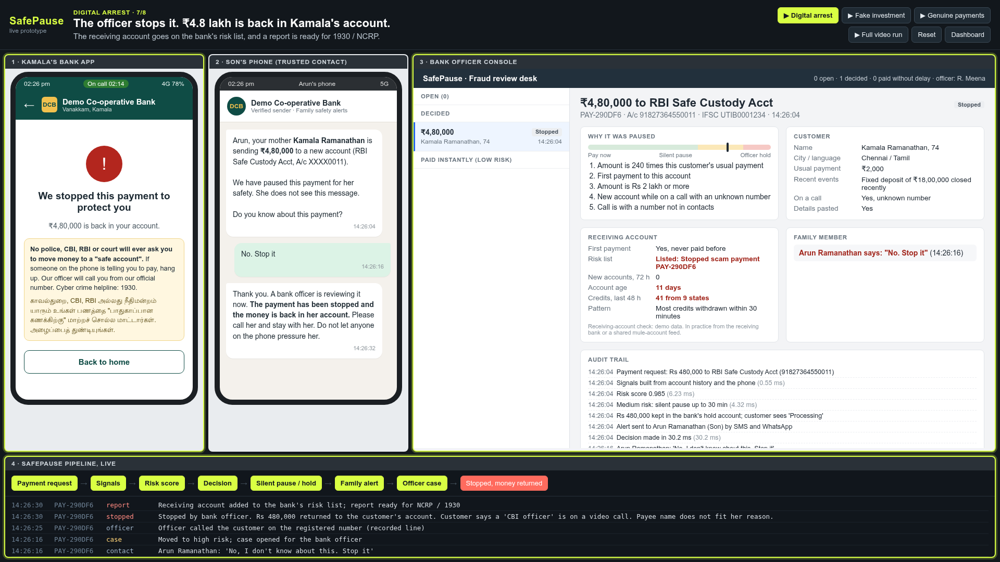
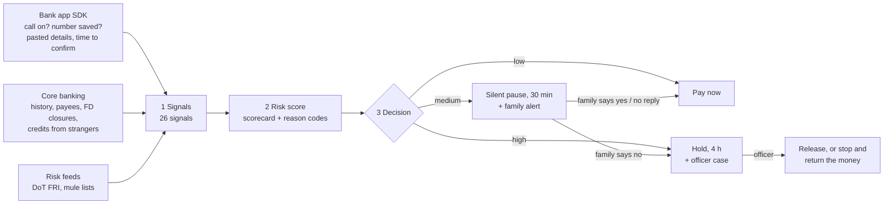
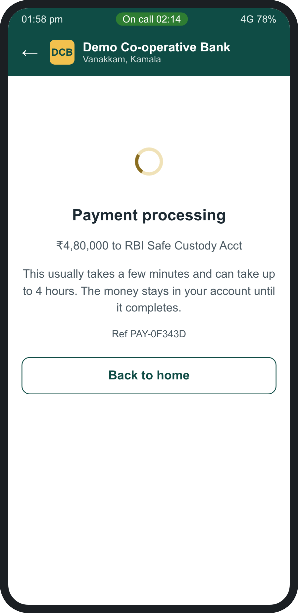
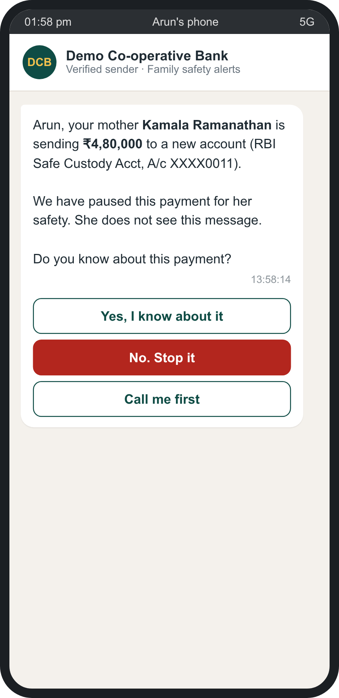
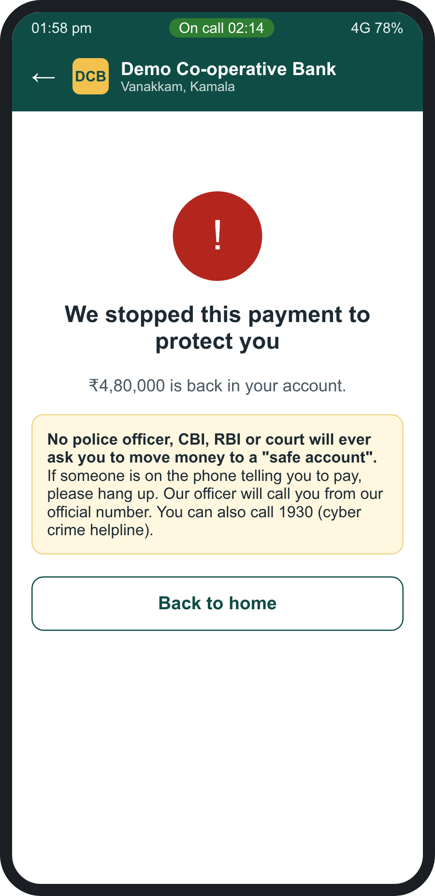
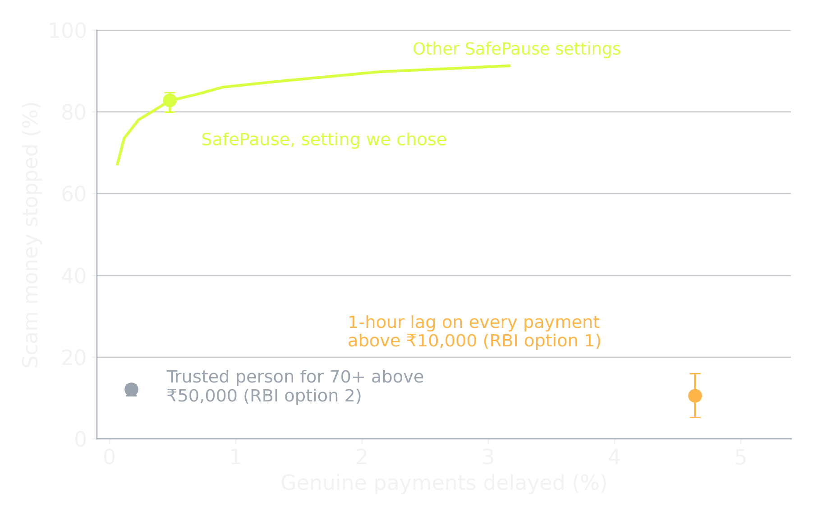
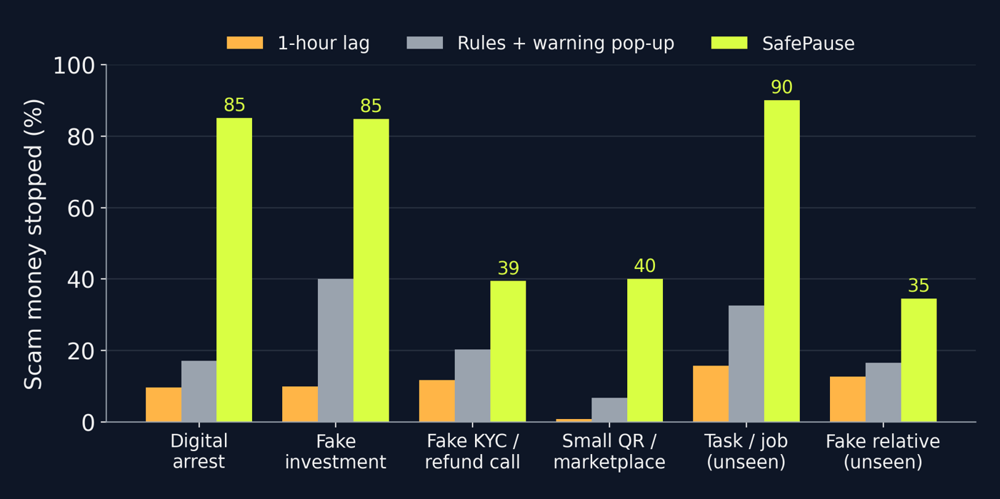

# SafePause

**Stop the scam payment, not every payment.**

SafePause is a safety layer for bank apps in India. It spots payments that a customer is being *talked into* making (digital arrest, fake investment, fake KYC calls), quietly pauses only those, asks a family member the customer chose in advance, and lets a bank officer make the final call. Genuine payments go through as they do today.

Built for **K! Hacks 4.0** (Kurukshetra 2027, CEG Tech Forum), FinTech track, by team **Overclocked Engineers** (Sanmugavel B, Maathesh Thilak K), Madras Institute of Technology, Anna University.

**This is a complete working engine, not a mock-up.** Every payment in the demo runs through the real code in this repository: signals, trained model, decision rules, family alert, officer console and audit log. It is not connected to a real bank yet, so bank and phone data are simulated, and a shadow pilot is the next step.


*The working prototype: a ₹4.8 lakh digital-arrest payment has just been stopped and the money is back in the customer's account.*

| | |
|---|---|
| **Pitch deck** | [docs/SafePause_KHacks4.0_deck.pdf](docs/SafePause_KHacks4.0_deck.pdf) |
| **Demo video (2 min silent screen recording)** | [demo-video/SafePause_demo_screen_recording.mp4](demo-video/SafePause_demo_screen_recording.mp4) |
| **Run it yourself** | `cd prototype && python3 server.py` then open http://localhost:8600 (no installs needed) |
| **Every number, with its source** | [research/RESEARCH_NOTES.md](research/RESEARCH_NOTES.md) |

---

## 1. The problem

> "...why your AI operated tools in the bank did not deem it fit to alarm him, that this transaction is suspicious?"
> Chief Justice of India Surya Kant, Supreme Court hearing on digital-arrest scams, 9 Feb 2026 (LiveLaw)

- **28 lakh** frauds were reported on the National Cybercrime Reporting Portal in 2025, worth **₹22,931 crore** (RBI Discussion Paper, 9 Apr 2026).
- RBI says account takeover is now "negligible". Most fraud is **authorised push payment**: the real customer, on their own phone, with the right PIN, pays the scammer.
- **98.5%** of the money lost is in payments above ₹10,000.
- Victims are coached to lie. In real cases they told bank staff the money was for "buying land" or "my son's property".

In a branch, a person sometimes notices. In a mobile app, nobody does.

| Real case | What happened |
|---|---|
| Navi Mumbai, Nov 2024 | Manager saw the payee "Royal enterprises" did not fit the "medical" reason. ₹12 lakh saved. |
| Agra, Sep 2026 | 80-year-old closed FDs to send ₹81 lakh. The bank **called his daughter-in-law**, who knew about the fake-police calls. Stopped. |
| Hyderabad, Oct 2026 | Six transfers in five days, over ₹1.5 crore, to two accounts. The report mentions no bank stepping in. |

**RBI's proposed fixes treat everyone the same:** a 1-hour lag on every payment above ₹10,000, or a trusted person approving every payment above ₹50,000 by anyone 70+. RBI's own paper asks whether the lag should instead be based on the bank's risk assessment. SafePause is that risk-based version.

---

## 2. How SafePause works



| Tier | What the customer sees | What happens |
|---|---|---|
| **Low** (99.5% of genuine payments) | Paid | Nothing changes |
| **Medium** | "Processing" | The trusted contact gets: *"Do you know about this payment?"* Yes releases it at once; No sends it to an officer; no reply releases it after 30 min |
| **High** | "Processing" | A bank officer sees the reasons in plain words, calls the customer, then stops it (money returned) or releases it |

**Four design rules**
1. **Don't tip off the scammer.** The screen says "processing", which is true. A scammer listening on the call hears nothing unusual.
2. **Ask someone who is not under pressure.** The victim is coached; their son or daughter is not.
3. **A person decides.** The model never moves money or blocks it for good (in line with RBI's FREE-AI guidance on human oversight).
4. **Every pause is explained** in plain words, to the officer and in the audit trail.

The customer agrees to this when opening the account, can change the trusted contact (24-hour cooling period, as RBI suggests), and the contact only ever sees the amount and the payee name, never the balance.

---

## 3. The working prototype

Python 3 standard library + SQLite. No `pip install`.

```bash
cd prototype
python3 server.py          # http://localhost:8600
```

Open **http://localhost:8600** at 1920 x 1080 and click **Full video run**. It plays three stories with captions:

| Story | What you will see |
|---|---|
| **Digital arrest** (Kamala, 74) | FD closed yesterday, on a call with "CBI". She pastes account details and pays ₹4.8 lakh. Paused in ~25 ms, app says "processing", her son is asked, he says No, the officer sees the reasons and an 11-day-old receiving account, calls her, stops it. Money back, warning shown in English and Tamil. Her second attempt goes straight to hold. |
| **Fake investment** (Rahul, 29) | No phone call. A ₹1,200 "profit" arrives from a stranger, then he pays ₹10,000 to a new account. Stopped at the first payment. |
| **Genuine payment** | Rahul books a bike: ₹45,000 to a new dealer. Paid instantly, no pop-up. |

| Screen | URL |
|---|---|
| Demo stage (all screens together) | `/` |
| Customer bank app | `/app.html` |
| Trusted contact's phone | `/contact.html` |
| Bank officer console | `/officer.html` |
| Live pipeline log | `/pipeline.html` |
| Branch dashboard | `/dashboard.html` |

<p>



</p>

**API**
| Endpoint | Purpose |
|---|---|
| `POST /api/pay` | Submit a payment with phone signals; returns status, tier, score, reasons, decision time |
| `POST /api/score` | Score only, nothing stored (for integration tests) |
| `POST /api/contact` | Trusted contact's answer: `expected`, `not_expected`, `call_me` |
| `POST /api/officer` | Officer decision: `release` or `stop` |
| `GET /api/state` | Everything the screens show |

Code map: `prototype/engine/pipeline.py` (signals, scoring, decision, actions, timers), `prototype/engine/model.json` (the trained model), `prototype/server.py` (API, demo data), `prototype/web/` (screens), `prototype/tests/` (Playwright end-to-end test and recorder).

Measured decision time on a laptop: **17 to 30 ms** per payment.

---

## 4. Does it work? The simulation

We cannot get real bank data as students, so we built a **synthetic bank** and were strict about it:

- **30,000 customers, 60 days, 5.76 lakh payments, 6,000 scam cases** across 6 scam types, modelled on published cases.
- **Calibrated to RBI's own figures:** payments of ₹10,000 or more are 45% of our scam payments by count and 98% by value (RBI: 45% and 98.5%).
- **Hard genuine cases kept in:** big first payments, FDs closed for real needs, family emergencies paid during a call, builder instalments.
- **Fair test:** trained on month 1 using 4 scam types, tested on month 2 with all 6. Two scam types (task/job scams, fake-relative voice calls) were **never seen in training**.
- **Unknown human behaviour** (does the family reply? does the officer spot it? does the victim ignore warnings?) is drawn from ranges in **200 Monte Carlo runs**. Results show the median and the 90% range.



| Approach | Scam money stopped | Genuine payments delayed |
|---|---|---|
| No safeguard (today's instant payments) | 0% | 0% |
| Rules + "are you sure?" pop-up | 33% (18-44%) | 0%, but 553 pop-ups per 1,000 customers a month |
| **1-hour lag on every payment ≥ ₹10,000** (RBI option 1) | 11% (5-16%) | 4.64% |
| **Trusted person for 70+, every payment > ₹50,000** (RBI option 2) | 12% (11-13%) | 0.17% |
| **SafePause** | **83% (80-85%)** | **0.48%**, median 14 min |

**What each part adds**
| Variant | Scam money stopped |
|---|---|
| Full SafePause | 83% |
| Without the trusted contact | 80% |
| Hold shown openly to the customer (scammer moves them to another bank) | 65% |

**By scam type** (SafePause): digital arrest 85%, fake investment 85%, task/job scam (unseen) 90%, fake KYC call 39%, small QR/marketplace 40%, fake relative (unseen) 35%.



Model: logistic scorecard with amount bands, AUC 0.98 on seen scam types and 0.97 on unseen types.

### Real cases replayed
Published cases rebuilt from news reports (equal splits assumed where only a total was reported; cautious defaults: details typed, receiving account not on any risk list).

| Case | Amount at stake | SafePause pauses at | Without the call signal |
|---|---|---|---|
| Hyderabad, Oct 2026 | ₹1.5 crore, 6 transfers | payment 1 | payment 2 |
| Jodhpur, Feb 2026 | ₹2.07 crore, 2 transfers | payment 1 | payment 1 |
| Navi Mumbai, Nov 2024 | ₹33.9 lakh, 4 transfers | payment 1 | payment 3 |

Reproduce everything:
```bash
cd sim
python3 generate.py    # synthetic bank (writes sim/data/, ~20 s)
python3 evaluate.py    # train the model + 200 runs (~6 min)
python3 charts.py
python3 replay.py
```

---

## 5. Why this is feasible now

- **The signals already exist.** Android lets an app know a call is active, and with the customer's permission the phone can check the number against contacts and send only "saved" or "not saved". No call audio is read. WhatsApp calls do not expose the number, so we also replay cases with the call signal removed. Google already warns users in India, the UK and Brazil who open finance apps while screen-sharing on an unknown call (Google Security blog, Dec 2025).
- **Risk-based holds are already law elsewhere.** Since October 2024, UK banks may delay a payment for up to 4 business days when they have reasonable grounds to suspect fraud.
- **Indian regulation is moving this way.** RBI's April 2026 paper asks whether the lag should be risk-based; the Supreme Court (4 Aug 2026) ordered RBI to adopt a procedure for temporary debit holds; RBI's revised rules on fraudulent e-banking transactions apply from 1 Jan 2027.
- **A real bank already did our family step by hand.** In Agra (Sep 2026) the bank stopped an ₹81 lakh transfer by calling the customer's daughter-in-law.

## 6. Business model (proposed)

- **Customers:** 1,457 urban co-operative banks, 28 regional rural banks and 11 small finance banks first: many older and rural customers, small fraud teams. Then UPI apps, then large banks through core-banking vendors.
- **Pricing:** ₹3 lakh one-time setup per bank + ₹2 per mobile-banking user per month; partner channel through core-banking vendors and cyber-fraud insurers.
- **Example:** a bank with 1 lakh mobile users. Its customers face about ₹4.1 crore a year in scam losses at the national average (₹22,931 crore / 55.49 crore UPI users ≈ ₹413 per user). SafePause would cost ₹24 lakh a year and about 22 officer reviews a day.
- **Path:** 3-month shadow pilot with one co-operative bank (score only, nobody paused) → compare with its fraud reports → RBI Regulatory Sandbox → paid roll-out.

## 7. Honest limits

- All results come from **synthetic data**. They show the design works under realistic assumptions, not that it will reach 83% at a real bank. A shadow pilot comes first.
- **One-shot scams** (a single payment during a fake KYC call or a cloned-voice "relative") are caught only 35-40% of the time; there is no pattern yet. Telecom signals such as DoT's Financial Fraud Risk Indicator can help.
- The receiving-account details in the officer console are **demo data**; in practice they would come from the receiving bank or a shared mule-account feed.
- A silent pause needs clear consent at account opening and RBI's approval. We designed it so the wording is always true and the money never leaves the customer's account until a decision.

## 8. Repository layout

```
prototype/        working system (Python + SQLite, no installs)
  engine/         pipeline.py (signals, score, decision, actions), model.json
  web/            customer app, trusted-contact phone, officer console, pipeline, dashboard, demo stage
  tests/          Playwright end-to-end test, screenshot and video recorder
sim/              synthetic bank, model training, 200-run comparison, charts, real-case replay
research/         sources for every number and quote
docs/             pitch deck (PDF), images
demo-video/       2-minute silent screen recording of the full demo
```

## 9. Main sources

1. RBI, Discussion Paper "Exploring safeguards in digital payments to curb frauds", 9 Apr 2026
2. Supreme Court of India: hearing of 9 Feb 2026 (LiveLaw); order of 4 Aug 2026, *In Re: Victims of Digital Arrest Related to Forged Documents*, 2026 SCC OnLine SC 1532
3. The420.in, Bank stops ₹81 lakh digital arrest transfer, Agra, Sep 2026
4. The420.in, Hyderabad digital-arrest fraud, Oct 2026
5. Free Press Journal, Navi Mumbai bank manager saves 80-year-old, 29 Nov 2024
6. ETV Bharat, Mangaluru manager saves couple from losing ₹84 lakh, 5 Dec 2025
7. UK Payment Services (Amendment) Regulations 2024; FCA guidance FG24/6
8. Google Security blog, in-call scam protection for financial apps, 3 Dec 2025
9. Lok Sabha reply: 55.49 crore UPI users, June 2026
10. RBI (Commercial Banks - Responsible Business Conduct) Third Amendment Directions, 2026 (from 1 Jan 2027); ELP law note, June 2026
11. RBI, co-operative banks publication, 29 Dec 2025; RBI FREE-AI framework, 13 Aug 2025
12. ETV Bharat, Jodhpur digital-arrest case, 24 Feb 2026

Full notes, including which facts come from primary and which from secondary sources: [research/RESEARCH_NOTES.md](research/RESEARCH_NOTES.md).

---
All customer names and the "Demo Co-operative Bank" in the prototype are fictional. Phone numbers are masked.
